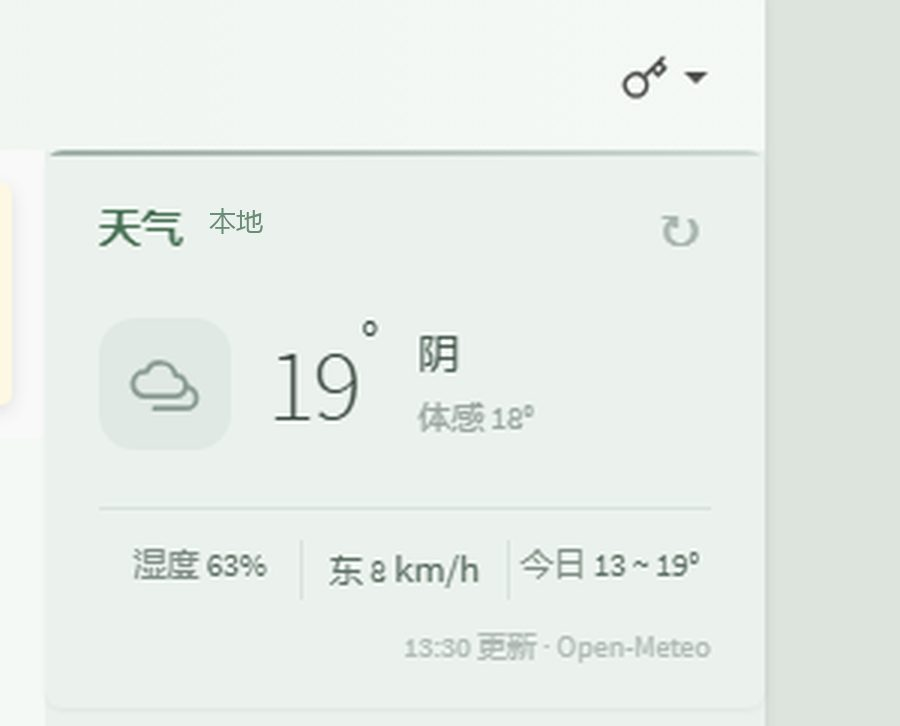

# Typecho Handsome 天气控件

给 Typecho 的 Handsome 主题加一个右侧栏天气卡片：**零模板改动、零 API Key、零第三方私有接口**。



数据由同源的 PHP 代理向 [Open-Meteo](https://open-meteo.com/en/docs) 取值，坐标写死在服务端常量里；样式和脚本通过主题自带的 `customCss` / `customJs` 注入，主题升级不会覆盖，删掉标记块即可卸载。

---

## 为什么不用 IP 定位

常见的天气控件做法是「按访客 IP 猜城市 → 查天气」。我拆过一套这样的实现：前端只发一个**无参数** GET 到作者自建接口，服务端从 TCP 连接读 `remote_addr`，IP 库 → 经纬度 → 天气 API 全在服务端跑完，一次返回 `{city, weather:{...}}`。

问题出在 IP 库给回的坐标和城市名经常对不上。实测记录（2026-11-06）：

| 定位方式 | 卡片上的城市 | 实际用于查询的位置 | 结果 |
| --- | --- | --- | --- |
| 某私有 IP 接口 | 返回的省份城市名 | 大圆距离 **773.6 km** 外的另一组坐标 | 16.6° 晴 |
| 固定坐标 | 与坐标一致 | 同一坐标 | 18.8° 阴 |

把那组「错配坐标」直接送进 Open-Meteo，返回 16.7° 晴，和接口给的 16.6° 几乎一致 —— **温度数值本身没问题，是算错了地方**。此外该接口多次返回 `weather: []` 或空响应，前端会一直卡在「正在获取」。

两个「准」要分开看：

- **数值准不准**：取决于天气数据源和坐标。只要都用 Open-Meteo，就是同一档。
- **算的是哪儿准不准**：取决于定位方式。IP 拿到的是运营商出口位置，精度到城市级，还会错配。

对个人博客来说，天气是站点氛围元素而不是给访客查天气的工具。为了它引入 IP 库和第三方私有接口，代价是错配数据、接口不稳定，还要把每个访客的 IP 交给别人。所以我砍掉了整段定位，改成把坐标写死在配置里，卡片上明确标出城市名，不让访客误读。

如果确实要「访客当地天气」，正确做法是浏览器 Geolocation 授权 + 前端直连 Open-Meteo，坐标精度比 IP 猜高几个数量级，也不用把 IP 交出去；代价是会多一个授权弹窗。本项目没做这层，留成一个明确的可选方向。

---

## 文件

| 文件 | 作用 | 放哪 |
| --- | --- | --- |
| `weather.php` | 服务端数据代理：请求 Open-Meteo、文件缓存、降级、WMO 码转中文 | Typecho 站点根目录 |
| `weather.css` | 卡片样式，跟随 Handsome widget 规范与 grass 配色，含暗色模式 | 注入 `customCss` |
| `weather.js` | 挂载、渲染、SVG 图标、刷新、PJAX 重挂 | 注入 `customJs` |
| `install.php` | 幂等安装脚本，把上面两个文件写进主题设置并回读校验 | 任意目录，执行一次 |

### 数据链路

```
浏览器 ──GET /weather.php──> 站点 PHP ──> 文件缓存(15 min)
                                  │  未命中
                                  └──GET──> Open-Meteo /v1/forecast
                                            (WGS84 坐标 + current + daily)
                                  <──JSON── 提取 / 降级 / 缓存
浏览器 <──同源 JSON── 卡片渲染（localStorage 再缓存 10 min）
```

`weather.php` **不接收任何外部参数**（坐标是常量），所以没有 SSRF 和注入面。`force=1` 只影响是否跳过缓存，且距上次真实回源不满 20 秒时不生效，防止刷新按钮被点爆上游。

---

## 安装

前置：Typecho + Handsome 主题（主题目录名为 `handsome`）、PHP 7.4+、PHP cURL（没有 cURL 时会自动退回 `file_get_contents`）。**先备份数据库**，脚本会改 `typecho_options` 里的一行。

1. 把 `weather.php` 复制到站点根目录，改顶部三个常量：

   ```php
   $CITY = '本地';     // 卡片上显示的名字
   $LAT  = 39.9042;    // 示例纬度，换成你自己的
   $LON  = 116.4074;   // 示例经度，换成你自己的
   ```

   浏览器直接访问 `/weather.php`，应返回类似：

   ```json
   {"ok":1,"city":"本地","temp":18.8,"desc":"局部多云","humidity":61,"source":"Open-Meteo","cached":0}
   ```

2. 把 `weather.css`、`weather.js` 和 `install.php` 放在同一目录，执行：

   ```bash
   php install.php /你的/typecho/站点根目录
   # 可选：附带 HTTP 自检（绕过 CDN 直连本机 nginx）
   php install.php /你的/typecho/站点根目录 your-domain.com
   ```

   脚本会读站点 `config.inc.php` 拿数据库连接信息（不硬编码任何凭据）、备份原主题配置、用 `JG-WEATHER-START/END` 标记块幂等替换 `customCss` / `customJs`，最后回读校验字段数没变、标记各只出现一次。重复执行是安全的。

3. 前台刷新。若仍显示旧内容，清一次 CDN 缓存（建议 HTML 不缓存）或 Ctrl+F5。

**不想跑脚本也行**：把 `weather.css` 全文粘进主题设置「自定义 CSS」、`weather.js` 全文粘进「自定义 JavaScript」，效果一样。标记块只是为了让卸载方便。

### 卸载

从主题设置的 `customCss` / `customJs` 里删掉 `/* JG-WEATHER-START */` 到 `/* JG-WEATHER-END */` 之间的内容，再删掉站点根目录的 `weather.php`。备份在 `站点根目录/../weather-backup/`。

---

## API 与限流

依据 Open-Meteo 官方文档核对，日期 **2026-11-06**：

- 普通调用**不需要 API Key**；`apikey` 仅商业客户访问保留资源时才需要。
- 免费档原文：`Only for non-commercial use and less than 10.000 daily API calls.` 商业使用请购买其商用许可。
- `current` 支持所有 hourly 变量；本项目取 `temperature_2m`、`relative_humidity_2m`、`apparent_temperature`、`weather_code`、`is_day`、`wind_speed_10m`、`wind_direction_10m`。当前实况基于 15 分钟模型数据，返回里的 `interval=900` 就是它。
- `daily` 取 `temperature_2m_max` / `temperature_2m_min`。**带 daily 字段时 `timezone` 是必需的**，所以请求里固定传了 `timezone=Asia/Shanghai`；`forecast_days=1`（范围 0–16，默认 7）。
- `weather_code` 只返回数字，文字描述要客户端自己映射，官方给了 WMO 表。`weather.php` 里的中文映射按该表对齐，包含容易漏掉的 `97`（强雷雨）；`96` / `99` 分别对应伴小冰雹、伴大冰雹的雷雨。

按 15 分钟缓存算，一天最多回源 `24 × 60 / 15 = 96` 次，远低于免费档上限；前端另有 10 分钟 `localStorage` 缓存，访客侧的重复请求不会打到服务端。

---

## 实现里几个踩过的点

- **暗色模式不能靠背景色猜**。第一版读 `getComputedStyle(document.body).backgroundColor`，结果 body 常是透明 `rgba(0,0,0,0)`，被算成深色，白卡片直接变黑。改成检测 Handsome 固定加在 `<html>` 上的 `theme-dark` 类，再用主题 CSS 变量做兜底。
- **全宽模板没有右侧栏**。Handsome 的 `cross.php`（时光机）等模板不输出 `#sidebar`，控件自然不显示。这是跟随主题的正确行为，硬塞进去反而不协调。
- **PJAX 换页会冲掉卡片**。监听 `pjax:end` / `pjax:complete`，再加 `MutationObserver` 兜底重挂。
- **风格跟着主题走，别把原主题的皮一起搬**。原实现是紫色玻璃拟态 + 雨雪粒子动画 + 温度滚动数字；这里全去掉，只留「按 WMO 天气码微调顶部渐变条和图标颜色」，其余按 Handsome 的 widget 规范来：白底、6px 圆角、细阴影、内联 SVG 图标。
- **上游挂掉要能用**。缓存过期但回源失败时，返回旧数据并标 `stale=1`，卡片底部显示「缓存数据」；完全没缓存才显示重试入口。

## 已验证环境

Typecho 1.3.0 + Handsome 10.1.0 + PHP 8.2，桌面与移动宽度、浅色与暗色模式、首页 / 文章页 / 独立页面、PJAX 换页。其他 Typecho / Handsome 版本未逐个验证；主题目录名不是 `handsome` 时改 `install.php` 顶部的 `OPTION_NAME`。

---

## 许可

MIT，见 [LICENSE](LICENSE)。

天气数据由 Open-Meteo 提供，使用时遵守其免费档的非商业条款；本项目与 Open-Meteo 无关联。参数与额度以[官方文档](https://open-meteo.com/en/docs)为准，最后核对日期 2026-11-06。
